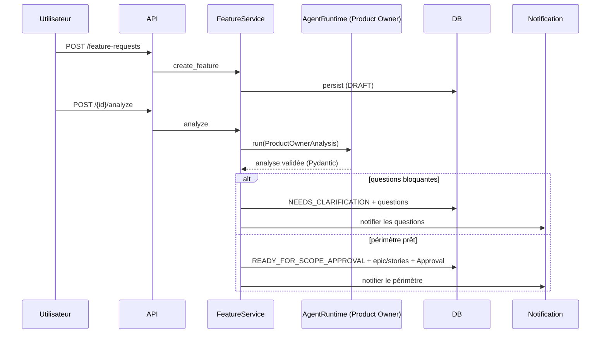

# Orchestration des agents

Un `AgentRuntime` (port) exécute un agent avec un rôle, des instructions, un
contexte, un schéma de sortie structuré, un identifiant de corrélation, une
limite de temps et une politique de retry.

## Séquence création d'une feature

## Implémentations
- `MockAgentRuntime` — déterministe, sans clé API (démo + tests).
- `OpenAICompatibleAgentRuntime` — endpoint compatible Chat Completions ; sortie
  JSON validée par Pydantic ; retry configurable.
- `GitHubAgenticRuntime` — préversion, derrière un feature flag, non requis
  localement.

## Prompts
Versionnés dans `packages/adf/adf/agent_runtime/prompts/`. Chaque prompt définit
objectif, entrées, format de sortie, interdiction d'inventer, obligation de
signaler les hypothèses, et traite les contenus externes comme non fiables.

## Traçabilité
Chaque exécution crée un `AgentRun` relié à feature/story/projet, avec
`correlation_id`. L'UI n'affiche que résumé/décisions/hypothèses/actions/erreurs,
jamais une chaîne de raisonnement privée.
