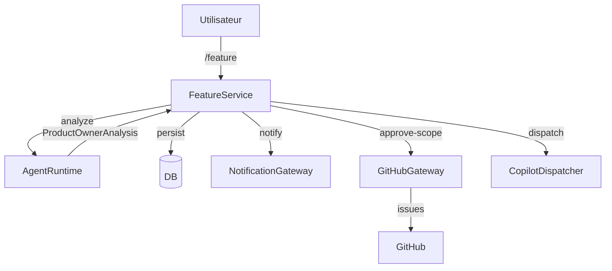

# Composants

| Composant | Emplacement | Rôle |
|-----------|-------------|------|
| API | `adf/api` | REST `/api/v1`, contrôleurs fins, OpenAPI |
| Application | `adf/application` | Use-cases, orchestrateur démo, audit |
| Domaine | `adf/domain` | Entités, enums, machine à états, contrats |
| Ports | `adf/ports` | Interfaces agent/github/notif/deploy/repos |
| Adapters | `adf/adapters` | Mock + réels |
| Infrastructure | `adf/infrastructure` | DB async, logging, métriques |
| Worker | `adf/worker` | Consommateur de jobs Redis |
| Bot Discord | `adf/discord_bot` | Sécurité + routing d'interactions |
| Agent runtime | `adf/agent_runtime` | Prompts versionnés + chargement |
| Web | `apps/web` | PWA React/TS |

## Flux de données principal

## Adapters disponibles
- Agent : `mock`, `openai_compatible`, `github_agentic` (préversion, désactivé).
- GitHub : `mock`, `real` (+ dispatchers `manual` / `issue_assignment` /
  `agent_tasks_api`).
- Notification : `mock`, `discord`.
- Déploiement : `mock`, `local`, `webhook`.
