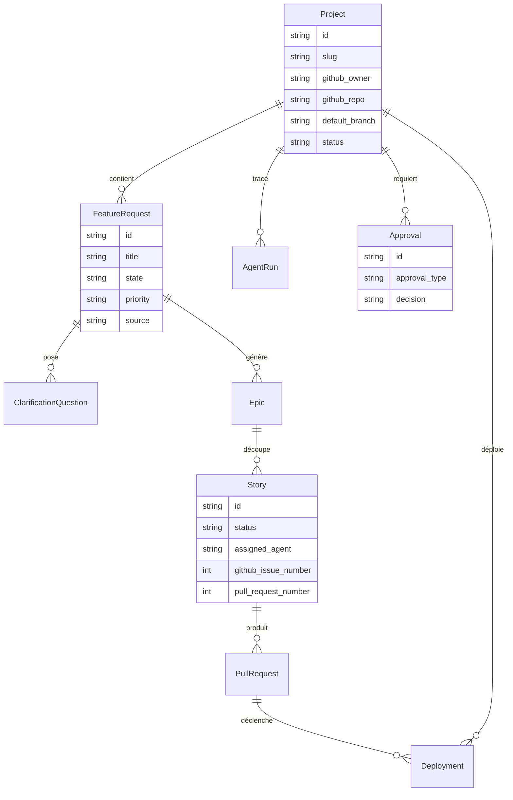

# Modèle de données

## Entités
Voir `packages/adf/adf/infrastructure/db/models.py`. Toutes les entités ont
`id` (UUID), `created_at`, `updated_at`. Les états sont des `StrEnum` explicites
(`packages/adf/adf/domain/enums.py`), persistés via `StrEnumType`.

Table clé pour l'idempotence : `webhook_events` (clé unique = delivery id).

## Contraintes & index
- `projects.slug` unique.
- `pull_requests(repository, number)` unique.
- Index sur les états (`feature_requests.state`, `stories.status`,
  `approvals.decision`) et sur `audit_logs(entity_type, entity_id)`.

## Multi-projets
La V1 gère un propriétaire et un dépôt cible configurables, mais le modèle
supporte déjà **plusieurs projets** (FK `project_id`).
