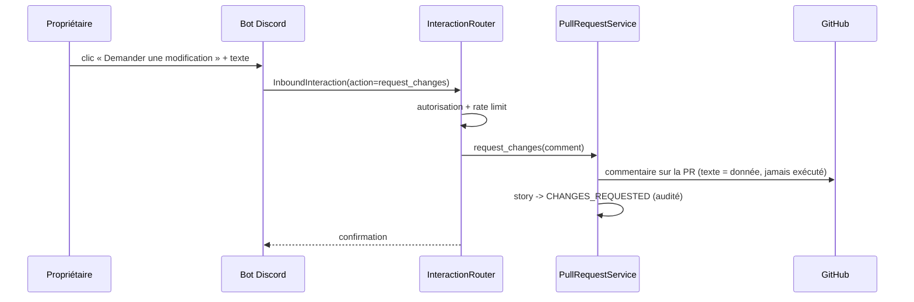

# Intégration Discord

Le bot peut tourner comme service dédié ou worker du backend. La logique de
sécurité et de routing est **indépendante du framework** et testée
(`adf/discord_bot/security.py`, `adf/discord_bot/interactions.py`).

## Commandes slash
`/feature`, `/status`, `/approve`, `/request-changes`, `/pause`, `/resume`,
`/help`. Interactions via boutons et modales ; réponses privées (ephemeral) pour
les informations sensibles.

## Demande de modification depuis Discord

Le texte de modification est : enregistré à l'audit, publié en commentaire de
PR, change l'état de la story, notifie le dispatcher, et n'est **jamais**
interprété comme une commande shell.

## Sécurité
- Allowlist des `Discord user IDs` (liste vide = tout le monde refusé).
- Allowlist serveur/canal, vérification de l'auteur, expiration des
  interactions côté Discord, rate limiting par utilisateur, audit complet.
- Variables : `DISCORD_BOT_TOKEN`, `DISCORD_APPLICATION_ID`, `DISCORD_GUILD_ID`,
  `DISCORD_CHANNEL_ID`, `DISCORD_ALLOWED_USER_IDS`.

Une réponse à une question est reliée de manière certaine à la bonne question
via le `question_id` porté par le `custom_id` du bouton.

Voir `docs/runbooks/discord-setup.md`.
