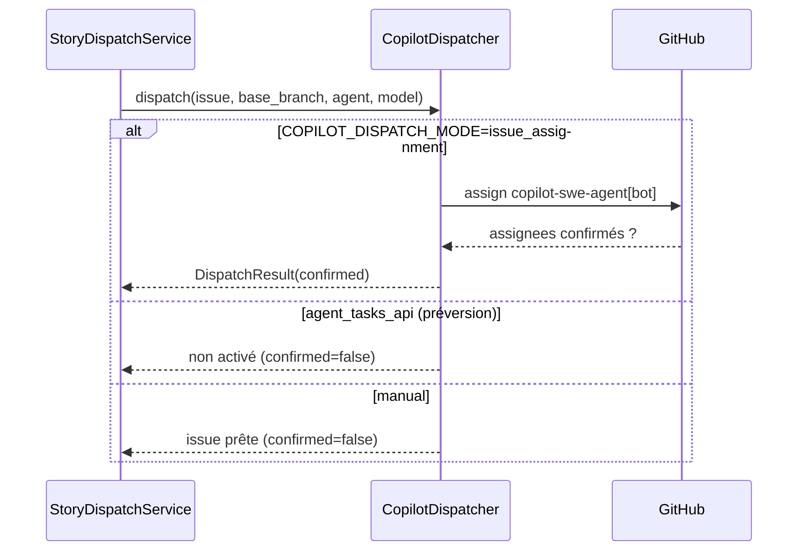
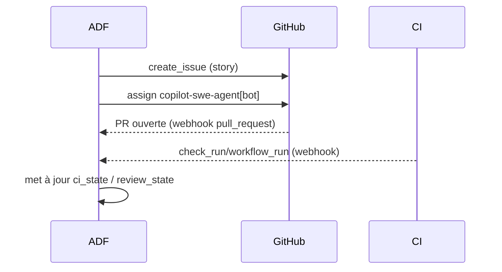

# Intégration GitHub

## Port et implémentations
`GitHubGateway` (`adf/ports/github_gateway.py`) : créer/mettre à jour/lire une
issue, ajouter des labels, affecter, lire une PR, commenter, lire les checks.
- `MockGitHubGateway` — en mémoire, déterministe.
- `RealGitHubGateway` — REST, gestion des rate limits (Retry-After + backoff),
  retries sur 5xx, journalisation **sans secret**.

## Dispatch Copilot

`COPILOT_DISPATCH_MODE = agent_tasks_api | issue_assignment | manual`.
On ne prétend **jamais** qu'une affectation a réussi sans confirmation GitHub.

## Séquence issue → pull request

## Webhooks
Événements gérés : `issues`, `issue_comment`, `pull_request`,
`pull_request_review`, `pull_request_review_comment`, `check_run`,
`check_suite`, `workflow_run`, `deployment`, `deployment_status`.

Chaque livraison : **signature vérifiée** (HMAC SHA-256), **idempotente**
(delivery id), enregistrée, met à jour l'état interne, déclenche les
notifications, sans bloquer la requête sur un traitement long.

## Permissions minimales
Voir `docs/security/secrets.md` et `docs/runbooks/github-setup.md`.

## GitHub agentic (préversion)
`AGENT_RUNTIME=github_agentic` et `AgentTasksApiDispatcher` restent derrière un
feature flag, désactivés par défaut. Les API agentiques GitHub sont en
préversion et peuvent ne pas être disponibles selon le compte/forfait ; le
fonctionnement local n'en dépend jamais.
