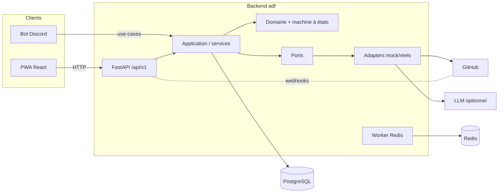

# Vue d'ensemble de l'architecture

AI Dev Factory est un monorepo : un backend Python en architecture hexagonale et
une PWA React. Le backend est la **source de vérité** des états métier.

## Couches (hexagonal)
1. **domain** — entités, enums, machine à états, contrats. Pur, sans framework.
2. **application** — use-cases orchestrant domaine + ports. Audit systématique.
3. **ports** — interfaces (`AgentRuntime`, `GitHubGateway`,
   `NotificationGateway`, `DeploymentGateway`, repositories).
4. **adapters** — implémentations mock et réelles.
5. **infrastructure** — DB async, logging JSON, métriques.
6. **api** — contrôleurs FastAPI fins.

Le domaine ne dépend jamais de GitHub, Discord, Redis ou d'un LLM.

## Composition
La sélection mock/réel se fait dans `application/container.py` (composition
root) à partir de la configuration. Le reste du code dépend uniquement des ports.
