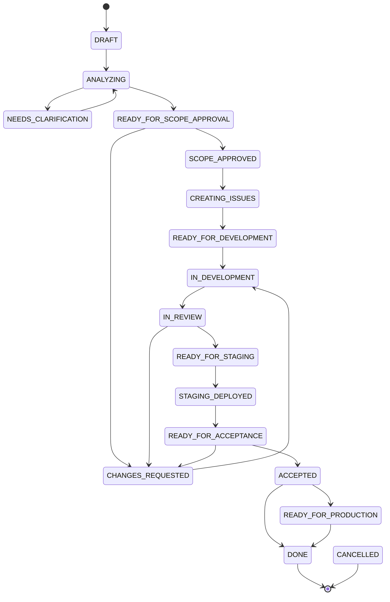
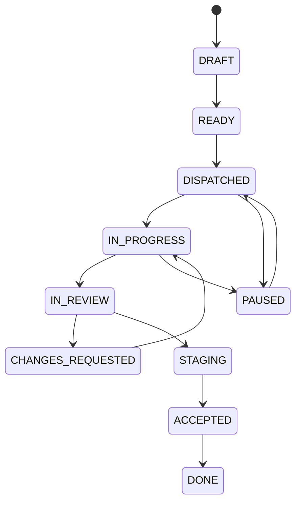

# Machine à états

Les transitions critiques sont validées dans le domaine
(`adf/domain/state_machine.py`). Une transition invalide lève
`InvalidStateTransition` (HTTP 409), jamais silencieuse.

## FeatureRequest

`BLOCKED` et `CANCELLED` sont accessibles depuis la plupart des états actifs.

## Story

Tests : `packages/adf/tests/test_state_machine.py`.
