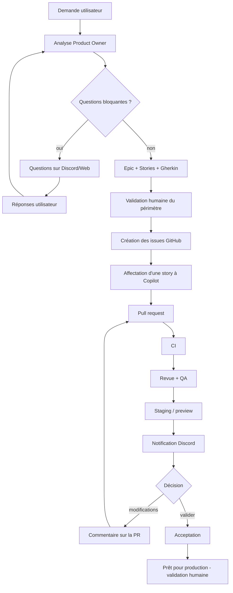

# Parcours utilisateur

Objectif : permettre à un propriétaire non disponible devant son ordinateur de
piloter la construction d'une application depuis son téléphone.

## Étapes détaillées
1. **Demande** : `/feature` (Discord) ou page « Nouvelle demande » (Web).
2. **Analyse** : l'agent Product Owner normalise, détecte règles/risques.
3. **Clarification** : questions bloquantes envoyées avec boutons + réponse libre.
4. **Périmètre** : epic + stories + critères Gherkin, présentés pour validation.
5. **Approbation** : bouton Approuver / Demander une modification / Annuler.
6. **Issues** : création GitHub (mock ou réel), labels appliqués.
7. **Dispatch** : story affectée à Copilot (ou prête pour affectation manuelle).
8. **PR/CI** : suivi via webhooks (ci_state, review_state).
9. **Revue/QA** : agents de revue et QA rendent un verdict.
10. **Staging** : déploiement (mock/local/webhook), notification.
11. **Décision** : validation ou demande de modification (commentaire sur la PR).
12. **Itération** puis **acceptation** ; la production reste à validation humaine.

Le parcours complet est démontrable hors-ligne : `make demo`.
